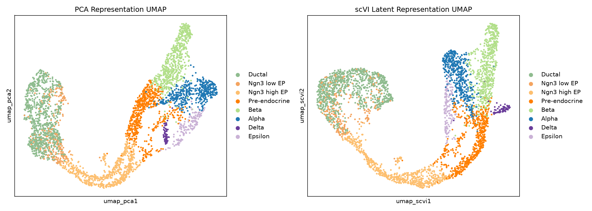
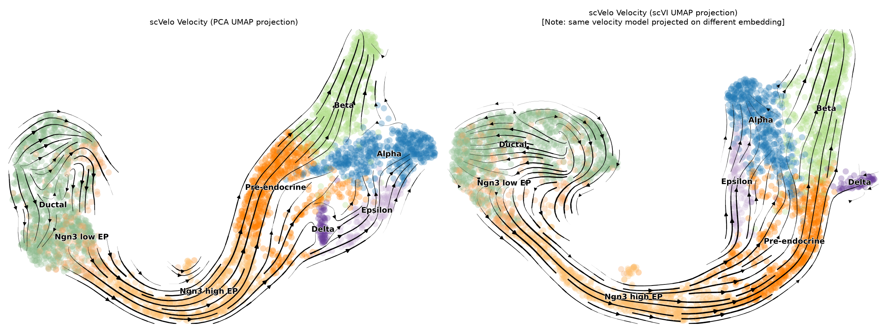
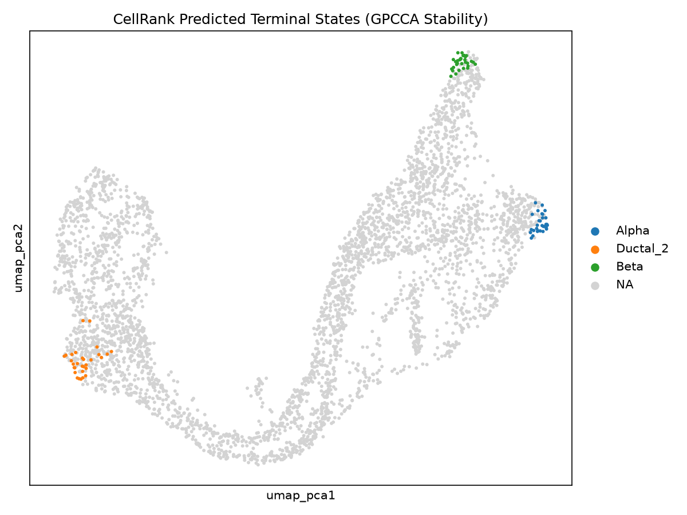
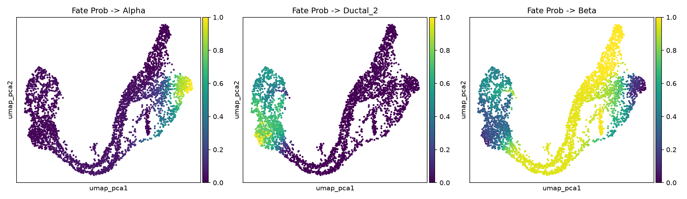
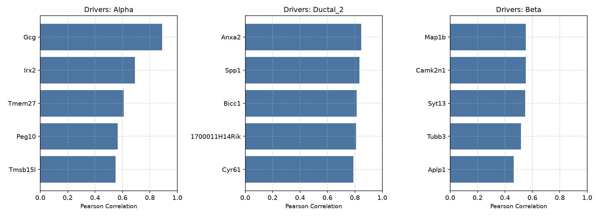
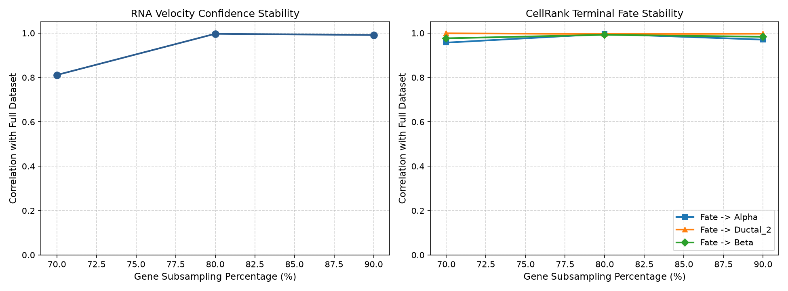

# Cell Fate Dynamics

*A small, reproducible exploration of cell-state transitions in single-cell RNA-seq data.*

## Why this project?

Single-cell RNA sequencing captures cells at different states, but usually not their full trajectories over time. This proof of concept explores what can be learned about cell differentiation from these noisy snapshots — and where the limits of such inferences lie.

The goal is **not** to claim a complete reconstruction of the underlying biological system. It is to build, compare, and critically evaluate a few accessible methods.

## Dataset

We use the public [pancreas dataset provided by scVelo](https://scvelo.readthedocs.io/en/stable/scvelo.datasets.pancreas.html), which contains cells at different stages of endocrine differentiation, including spliced and unspliced RNA measurements.

## Approach

1. **Explore and preprocess** the expression data; inspect cell types and basic quality metrics.
2. **Learn low-dimensional representations** with PCA (baseline) and a variational model such as [scVI](https://docs.scvi-tools.org/).
3. **Estimate transition directions** using [scVelo](https://scvelo.readthedocs.io/) and, if feasible, terminal-state probabilities with [CellRank](https://cellrank.readthedocs.io/).
4. **Evaluate the results** rather than relying on attractive visualizations alone.

A latent representation and an inferred transition model are distinct components; a 2D embedding alone does not establish cell dynamics.

## Questions to investigate

- Do PCA and scVI preserve known cell populations and intermediate states?
- Do inferred transitions follow biologically plausible differentiation paths?
- How stable are the conclusions across random seeds, selected genes, or added noise?
- Which findings can be interpreted, and which remain uncertain?

## Intended outputs

- One self-contained, runnable notebook (ideally on Google Colab).
- Clear figures comparing representations and inferred transitions.
- A small quantitative comparison, including at least one robustness check.
- A short discussion of limitations and unexpected or negative results.

## Key Results & Methodological Findings

The pipeline evaluates single-cell representation learning and dynamical transition modeling on 3,696 pancreatic endocrine cells across 2,000 highly variable genes:

| Metric / Analysis | Linear Baseline (PCA) | Variational Generative (scVI) | Note / Biological Context |
| :--- | :--- | :--- | :--- |
| **Cell-type Silhouette Score** | **0.1418** | **0.2322** | **+63.8%** separation of annotated cell populations |
| **$k$-NN Neighborhood Overlap ($k=15$)** | — | **0.1392** | Significant local manifold divergence between linear & non-linear spaces |
| **$k$-NN Neighborhood Overlap ($k=30$)** | — | **0.2032** | Preserved broad neighborhood topology across representations |
| **Mean Velocity Confidence** | 0.7882 | 0.7882 | Strong directional coherence across commitment paths |
| **Velocity Robustness (90% genes)** | $r = 0.9914$ | — | High trajectory stability under minor gene subsampling |
| **Velocity Robustness (80% genes)** | $r = 0.9970$ | — | High trajectory stability under moderate gene subsampling |
| **Velocity Robustness (70% genes)** | $r = 0.8113$ | — | Sensitivity and divergence below 80% variable genes |
| **Fate Robustness ($90\% \to 70\%$ genes)** | Alpha: $0.971 \to 0.957$<br>Beta: $0.984 \to 0.977$ | — | CellRank terminal fate probabilities remain robust even down to 70% genes |

### 1. Latent Representations & Local Geometry
scVI achieves clearer cell-type separation (silhouette score $0.232$ vs. $0.142$ for PCA) by explicitly modeling library size variability and count overdispersion with negative binomial distributions. However, the $k$-NN Jaccard neighborhood overlap ($13.9\%$ at $k=15$) shows that local geometry undergoes substantial non-linear reorganization between the two representations.



### 2. Transition Directions & Visual Projections
> [!NOTE]
> **Methodological Clarification**: The RNA velocity streamlines visualised on the PCA- and scVI-derived UMAPs project the **same underlying RNA velocity model** onto different 2D coordinate embeddings. Differences in streamline flows illustrate the visual distortions inherent to 2D projections rather than two independently trained dynamical models.



### 3. Predicted Terminal States, Fate Probabilities & Lineage Drivers
CellRank's Generalized Perron Cluster Cluster Analysis (`GPCCA`) stability criterion automatically predicts stable absorbing macrostates:
- **Alpha & Beta lineages**: Correctly captured as terminal endocrine outcomes driven by canonical transcription factors and lineage markers:
  - **Alpha**: `Gcg` ($r = 0.889$), `Irx2` ($r = 0.691$), `Tmem27` ($r = 0.609$)
  - **Beta**: `Map1b` ($r = 0.553$), `Camk2n1` ($r = 0.551$), `Syt13` ($r = 0.547$), `Nkx6-1` ($r = 0.496$)
- **Ductal cells**: Identified as an absorbing boundary in this snapshot because ductal cells represent a distinct, non-differentiating lineage in late endocrine morphogenesis.
- **Delta cells**: While biologically differentiated, Delta cells represent a rare subpopulation (70 cells, $\sim 1.9\%$ of the dataset). GPCCA detects Delta as an individual macrostate, but its reduced stability index reflects the difficulty of automated terminal state prediction on minor populations without prior constraints.



#### Fate Probabilities & Lineage Drivers
CellRank resolves absorbing Markov chain absorption probabilities towards each terminal state and prioritizes key driver genes correlated with lineage commitment:





### 4. Robustness & Perturbation Analysis
Trajectories and fate probabilities were evaluated across random gene downsampling subsets (90%, 80%, and 70% of highly variable genes). While direction confidence experiences moderate loss below 80% ($r = 0.811$), absorbing Markov fate probabilities demonstrate remarkable stability ($r > 0.95$ across all terminal lineages down to 70% genes).



### 5. Limitations & Scientific Caveats
- **Steady-state splicing assumptions**: Conventional RNA velocity models assume constant rates of transcription, splicing, and degradation across time, an assumption frequently violated during rapid transient differentiation bursts.
- **Snapshot inferences vs. lineage tracing**: Inferred transition graphs and fate probabilities remain model-based statistical reconstructions from static single-cell snapshots, which provide hypotheses rather than true longitudinal validation.

## Repository Structure

```text
├── data/                    # Dataset directory (.gitkeep, local cache)
├── figures/                 # Generated visualization figures & metrics.json
├── notebooks/               # Runnable analysis notebooks
│   └── 01_cell_fate_dynamics_exploration.ipynb
├── src/cell_fate_dynamics/  # Reusable core modules
│   ├── __init__.py
│   ├── data.py              # Data loading & preprocessing
│   ├── models.py            # scVI training & scVelo dynamics
│   ├── evaluation.py        # Silhouette, neighbor overlap, validation metrics
│   └── run_experiment.py    # Pipeline runner with CLI, caching & robustness
├── tests/                   # Automated unit & integration tests
│   ├── test_basic.py
│   └── test_evaluation.py
├── pyproject.toml           # Project metadata and dependencies (managed via uv)
└── README.md
```

## Quick Start

### Installation with `uv`

To clone and set up the development environment with all dependencies (including `jupyterlab`):

```bash
# Clone repository
git clone https://github.com/carabistouflette/cell-fate-dynamics.git
cd cell-fate-dynamics

# Install dependencies into virtual environment
uv sync

# (Optional) Install editable package
uv pip install -e .
```

### Running the Full Pipeline

```bash
# Complete run from scratch (trains scVI, fits velocity, computes GPCCA fates & robustness)
uv run python -m cell_fate_dynamics.run_experiment

# Fast re-execution using cached preprocessed AnnData and scVI latent space
uv run python -m cell_fate_dynamics.run_experiment --use-cache
```

### Running the Interactive Notebook

```bash
uv run jupyter lab notebooks/01_cell_fate_dynamics_exploration.ipynb
```

### Running Tests

```bash
uv run pytest
```
